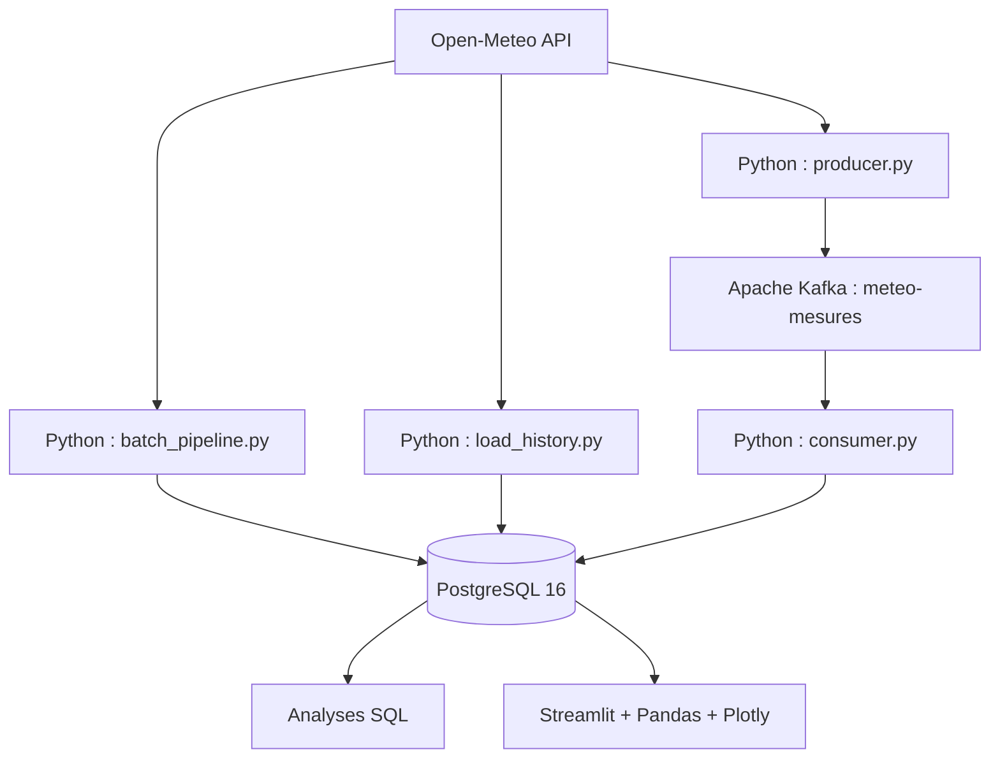

# 🌤️ Météo Data Platform

**Plateforme de données météorologiques | Data Engineering · Batch · Streaming · Analytics**

Projet de Data Engineering de bout en bout permettant de collecter les données météorologiques de **5 villes françaises**, de les traiter en batch ou en streaming, de les historiser dans PostgreSQL et de les explorer dans un dashboard Streamlit.

**Stack :** Python · Open-Meteo API · Apache Kafka · PostgreSQL 16 · Docker Compose · SQL · Pandas · Plotly · Streamlit

## 📊 Aperçu du dashboard

### Vue générale et évolution des températures


### Comparaison des températures moyennes


### Exploration des observations


Le dashboard propose un filtre par ville, des indicateurs clés, des graphiques interactifs et une consultation des observations stockées dans PostgreSQL. Les captures correspondent à une exécution locale du projet ; le dashboard n'est pas hébergé publiquement.

## 🎯 Objectifs du projet

- Extraire des données depuis une **API REST** et manipuler des réponses **JSON**.
- Construire un pipeline d'ingestion **batch** avec Python.
- Mettre en œuvre un pipeline **streaming** avec un Producer, Apache Kafka et un Consumer.
- Charger des observations horaires historiques dans PostgreSQL.
- Éviter les doublons avec une clé métier et un `UPSERT` SQL.
- Réaliser des analyses SQL et les visualiser dans Streamlit.
- Orchestrer les services locaux avec Docker Compose.

## 🏗️ Architecture



**Batch :** API → extraction et transformation Python → PostgreSQL  
**Streaming :** API → Producer Python → Kafka → Consumer Python → PostgreSQL  
**Analytics :** PostgreSQL → SQL / Streamlit

> Le pipeline streaming fonctionne par publication d'événements successifs. La collecte périodique entièrement automatisée n'est pas encore mise en place.

## 🛠️ Technologies

| Technologie | Utilisation |
| --- | --- |
| Python | Extraction, transformation et chargement |
| Open-Meteo | API météo REST |
| Apache Kafka 3.9.1 | Transport des événements |
| PostgreSQL 16 | Stockage et historisation |
| Docker Compose | Infrastructure locale |
| SQL | Agrégations et analyses |
| Pandas | Préparation des données pour le dashboard |
| Plotly | Visualisations interactives |
| Streamlit | Interface web analytique |

## 📁 Structure du dépôt

```text
meteo-data-platform/
├── assets/
│   ├── Page 1.png
│   ├── Page 2.png
│   └── Page 3.png
├── dashboard/
│   └── app.py
├── scripts/
│   ├── extract.py
│   ├── batch_pipeline.py
│   ├── load_history.py
│   ├── producer.py
│   └── consumer.py
├── sql/
│   ├── create_tables.sql
│   └── analyses_meteo.sql
├── .env.example
├── .gitignore
├── docker-compose.yml
├── requirements.txt
└── README.md
```

## 🚀 Installation et exécution

Les commandes suivantes sont destinées à **Windows PowerShell**, depuis le dossier du projet.

### 1. Prérequis

- Python 3.11 (version utilisée pour le développement)
- Docker Desktop et Docker Compose
- Git
- Un éditeur tel que VS Code

### 2. Cloner le dépôt

```powershell
git clone https://github.com/Massamba07/meteo-data-platform.git
cd meteo-data-platform
```

### 3. Préparer Python

```powershell
python -m venv .venv
.\.venv\Scripts\Activate.ps1
python -m pip install -r requirements.txt
```

### 4. Configurer les variables d'environnement

```powershell
Copy-Item .env.example .env
```

Modifier le fichier `.env` et remplacer le mot de passe d'exemple :

```dotenv
POSTGRES_USER=meteo
POSTGRES_PASSWORD=choisir_un_mot_de_passe
POSTGRES_DB=meteo_db
POSTGRES_PORT=5433
KAFKA_PORT=9092
```

**Ne jamais publier `.env` sur GitHub.** Le dépôt contient uniquement `.env.example` comme modèle.

### 5. Démarrer PostgreSQL et Kafka

```powershell
docker compose up -d
docker compose ps
```

Les services sont accessibles en local : PostgreSQL sur `127.0.0.1:5433` et Kafka sur `127.0.0.1:9092`.

### 6. Initialiser la base PostgreSQL

```powershell
Get-Content .\sql\create_tables.sql | docker exec -i meteo-postgres psql -U meteo -d meteo_db
```

La table `mesures_meteo` conserve notamment la ville, la date de mesure, la température, l'humidité et la vitesse du vent. La contrainte `UNIQUE (ville, date_mesure)` permet d'éviter plusieurs lignes pour une même observation métier.

### 7. Exécuter le pipeline batch

Pour récupérer la météo actuelle :

```powershell
python scripts/batch_pipeline.py
```

Pour charger des observations horaires historiques des cinq villes :

```powershell
python scripts/load_history.py
```

Le chargement utilise `ON CONFLICT` pour mettre à jour les observations existantes sans les dupliquer.

### 8. Exécuter le pipeline streaming

Créer le topic Kafka (une seule fois, ou après une recréation du conteneur Kafka) :

```powershell
docker exec meteo-kafka /opt/kafka/bin/kafka-topics.sh --bootstrap-server 127.0.0.1:9092 --create --if-not-exists --topic meteo-mesures --partitions 1 --replication-factor 1
```

**Terminal 1 — Consumer :**

```powershell
python scripts/consumer.py
```

**Terminal 2 — Producer :**

```powershell
python scripts/producer.py
```

Le Producer publie les mesures des villes de **Paris, Lille, Lyon, Marseille et Nantes**. Le Consumer lit les événements Kafka et les écrit dans PostgreSQL. Arrêter le Consumer avec `Ctrl + C`.

> Plusieurs messages Kafka peuvent correspondre à la même observation météo : le `UPSERT` PostgreSQL empêche alors les doublons sur `(ville, date_mesure)`.

### 9. Lancer les analyses SQL

```powershell
Get-Content .\sql\analyses_meteo.sql | docker exec -i meteo-postgres psql -U meteo -d meteo_db
```

Exemples d'analyses : nombre d'observations par ville, température moyenne, évolution horaire, température maximale et amplitude thermique.

### 10. Lancer le dashboard Streamlit

```powershell
python -m streamlit run dashboard/app.py
```

Ouvrir **http://localhost:8501** dans le navigateur. PostgreSQL doit être démarré et contenir des observations pour afficher les graphiques.

### 11. Arrêter l'infrastructure

```powershell
docker compose down
```

Cette commande conserve le volume PostgreSQL nommé. **Ne pas utiliser `docker compose down -v`** sauf si la suppression des données est volontaire.

> **Limite actuelle :** Kafka n'a pas de volume persistant dédié dans cette configuration. Recréer son conteneur peut supprimer les messages et nécessiter de recréer le topic.

## 🔐 Sécurité et limites

- Identifiants PostgreSQL lus depuis `.env`, ignoré par Git.
- Exemple de configuration fourni dans `.env.example`.
- Ports PostgreSQL et Kafka exposés uniquement sur l'interface locale IPv4.
- Kafka est configuré pour un usage **local et pédagogique**, sans authentification ni chiffrement du trafic.
- Le dashboard utilise une base PostgreSQL locale : les captures sont publiques, mais l'application n'est pas déployée en ligne.
- Le projet illustre l'ETL et le streaming ; il ne constitue pas une infrastructure de production.

## 🔭 Améliorations envisagées

- Automatiser les collectes avec un ordonnanceur.
- Ajouter des tests unitaires et des contrôles de qualité des données.
- Mettre en place une CI GitHub Actions.
- Ajouter la persistance Kafka et l'observabilité des pipelines.
- Déployer PostgreSQL et Streamlit sur une infrastructure accessible à distance.
- Enrichir le modèle de données et les indicateurs analytiques.

## 📚 Contexte

Projet pratique de **Data Engineering**, conçu pour expérimenter les principes d'intégration de données, d'ETL, d'API REST, de traitement batch, de streaming et de visualisation analytique.

**Auteur :** [Massamba GUEYE](https://github.com/Massamba07)  
**Dépôt :** [github.com/Massamba07/meteo-data-platform](https://github.com/Massamba07/meteo-data-platform)

**Source des données :** [Open-Meteo](https://open-meteo.com/)
